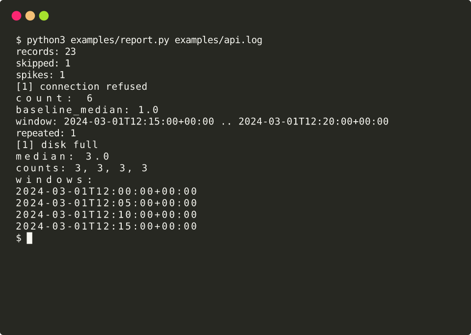

# logwatcher

`logwatcher` reads a saved application log and reports an error that suddenly bursts. A file can also be full of errors that have been noisy the whole time. The library separates those two cases, so a burst is visible on its own.

Parsing and spike detection are implemented as library functions. The runtime is the Python standard library only. The `logwatcher` command prints a usage hint and does not open a log file yet. New-pattern detection, `scan`, and follow mode are listed under [What's next](#whats-next).

## What it does

### Parse a log

`parse_log` reads a path or an iterable of lines and returns the records plus a count of skipped lines.

A line can have one of three shapes:

- An ISO-8601 timestamp, a level, and an optional message: `2024-03-01T12:00:00Z ERROR connection refused`. The date and time may be separated by `T` or a space. A timezone (`Z` or `±HH:MM`) is optional.
- A syslog-style line, matching Python logging's default timestamp: `2024-03-01 12:00:00,123 ERROR app.worker: job failed`. The logger name is required. The stored message is the text after `name:`.
- One JSON object per line, with a timestamp under `ts` or `timestamp` and a level under `level` or `severity`. The message is taken from `message`, or from `msg` when that is absent. A numeric timestamp is seconds since the Unix epoch, or milliseconds when the number is at least `1e12`.

`ERROR`, `FATAL`, and `CRITICAL` are errors. `WARN` and `WARNING` are warnings. Any other level is context. Level matching is case-insensitive. Blank lines are ignored and are not counted as skipped. Any other non-blank line that matches none of the shapes is skipped. When the source has non-blank lines and none of them match, `parse_log` raises `ParseError`. An empty file is a successful empty result.

A timestamp written without a timezone is a naive datetime. Spike detection reads that clock time as UTC.

### Detect a spike

`detect_spikes` counts records whose kind is `error`. Warnings, context lines, and records with no timestamp are left out. Aware timestamps are converted to UTC before they are placed in a window.

The error type is the message text exactly as parsed. Two messages that differ only by an id are different types. Folding those together is pattern detection, which is [issue #4](https://github.com/dkupratis-debug/log-watcher/issues/4) and is not implemented.

Counts for each message fall into fixed windows. The default window is 5 minutes, aligned to the Unix epoch, so a timestamp always lands in the same window. Empty windows are ignored. A quiet gap does not pull the baseline down to zero.

A window is a spike when both of these hold:

- it contains at least 3 events of that message
- that count is at least 3 times the median of the same message's other non-empty windows

The window under test is left out of its own median. Exactly 3 events, and exactly 3 times the baseline, still counts as a spike. A message that appears in only one window is never a spike, because there is no other window to compare with.

A message that stays at or above 3 events in every non-empty window, and never reaches the multiplier, is reported as repeated. The same message is not reported as both a spike and a repeated type.

The window, the minimum count, and the multiplier are arguments of `detect_spikes`. The defaults above are the ones the demo uses.

## Tech stack

- Python 3.11 and 3.12. The package requires Python 3.11 or newer, and [CI](.github/workflows/ci.yml) tests 3.11 and 3.12.
- The Python standard library only, at runtime. There are no runtime dependencies.
- setuptools builds the package.
- pytest and ruff are the development tools. They are installed with the `dev` extra.
- GitHub Actions workflow [`.github/workflows/ci.yml`](.github/workflows/ci.yml) runs on `ubuntu-latest` for every push and pull request. It installs the package with the dev extra, then runs `ruff check .` and `pytest`, once per Python version in the matrix.

## Install

From a clone of this repository:

```bash
python3 -m pip install -e ".[dev]"
```

The `dev` extra installs pytest and ruff. The package install also creates the `logwatcher` console script.

## Usage

`logwatcher` and `python3 -m logwatcher` print a usage hint and exit 0:

```
logwatcher: work in progress. Log parsing and detection are not implemented yet. Run `logwatcher --help` for usage.
```

`logwatcher --help` and `python3 -m logwatcher --help` exit 0 as well.

`parse_log` and `detect_spikes` are the calls that read a file and report spikes. [`examples/report.py`](examples/report.py) is a short demo of those two calls. `logwatcher scan` and `logwatcher follow` are not part of this version.

## Demo

[`examples/api.log`](examples/api.log) is fictional. It contains no hostnames, customer names, or credentials. Every matched line is ISO-8601 with a `Z` timezone.

From 12:00 to 12:20 UTC on 2024-03-01 the file has:

- `connection refused` once in each of the first three 5-minute windows, then six times in the window that starts at 12:15
- `disk full` three times in each of those four windows
- one `INFO` line (`worker started`) and one `WARNING` line (`queue delay`), which parse as records and are not counted as errors
- a final line, `this line is not a log`, which matches no shape and is skipped

Run this from the repository root after the install command above. The block under the command is the program's standard output from that run:

```bash
python3 examples/report.py examples/api.log
```

```
records: 23
skipped: 1
spikes: 1
  [1] connection refused
      count: 6
      baseline_median: 1.0
      window: 2024-03-01T12:15:00+00:00 .. 2024-03-01T12:20:00+00:00
repeated: 1
  [1] disk full
      median: 3.0
      counts: 3, 3, 3, 3
      windows:
        2024-03-01T12:00:00+00:00
        2024-03-01T12:05:00+00:00
        2024-03-01T12:10:00+00:00
        2024-03-01T12:15:00+00:00
```

`connection refused` in the 12:15 window has count 6. The median of its other windows is 1, and 6 is at least 3 times that baseline, so the window is a spike. `disk full` stays at 3 in every window. That meets the minimum of 3, and 3 is below 3 times the median of the other windows, so it is reported as repeated.

[`docs/spike-demo.svg`](docs/spike-demo.svg) is a terminal recording of the same command, rendered with [termtosvg](https://github.com/nbedos/termtosvg). The session shows the shell prompt, the command, and the standard output above. The still is the last frame of that recording.



## Tests

```bash
ruff check .
pytest
```

The CI workflow runs those two commands on Python 3.11 and Python 3.12.

## What's next

These issues are open. None of this behavior is in the repository yet.

- [#4 Detect new error patterns](https://github.com/dkupratis-debug/log-watcher/issues/4). Normalize each error to a pattern key: an `error_type` or `exception` field, then an exception class name in the message, then an HTTP 5xx token, then the message with digits and UUIDs replaced by a placeholder. The first time a key appears, mark it as new, even when it happens only once.
- [#5 CLI with text and JSON output](https://github.com/dkupratis-debug/log-watcher/issues/5). `logwatcher scan FILE` prints a text summary of total lines, errors, skipped lines, spikes, new patterns, and repeated types, with `--format json` for the same data.
- [#6 Tail / follow mode](https://github.com/dkupratis-debug/log-watcher/issues/6). `logwatcher follow FILE` watches a log that is still being written, stays on the standard library, and exits on SIGINT or SIGTERM.

## License

Released under the [MIT License](LICENSE).
